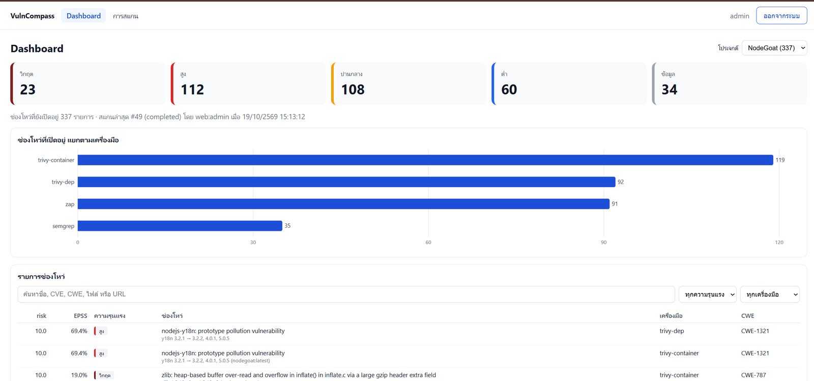
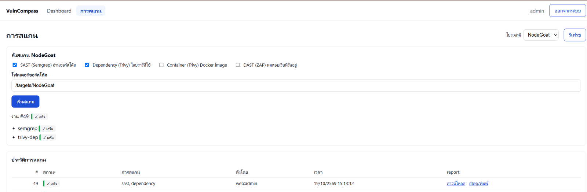
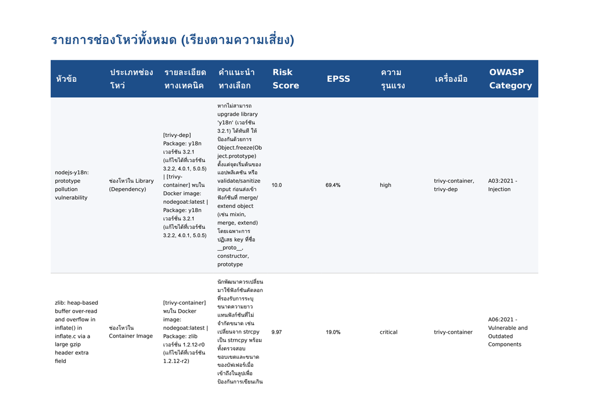
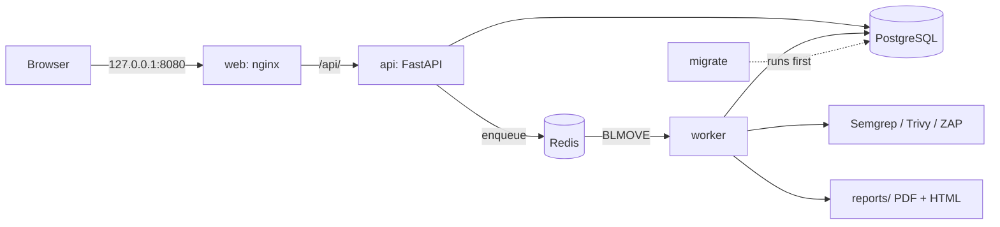

# VulnCompass

**An automated security assessment and reporting pipeline.** VulnCompass runs four scanners against a project, merges their results into one de-duplicated, risk-ranked list, tracks each finding over time, and produces a Thai-language PDF report. You can use it from a web app, from the command line, or as a security gate in CI.

[ภาษาไทย](README.th.md)



```powershell
docker compose --profile app up -d --build
# open http://localhost:8080
```

---

## What it does

| Scan type | Tool | Looks at |
|---|---|---|
| SAST | Semgrep | Source code |
| Dependency | Trivy `fs` | Libraries in lock files |
| Container | Trivy `image` | OS and library packages in a Docker image |
| DAST | OWASP ZAP | A running web application |

After the scans finish, the pipeline:

1. **Normalizes** each tool's output into one schema, with a stable fingerprint for each finding. A Semgrep fingerprint uses the matched code rather than the line number, so a finding keeps its identity when the lines around it move.
2. **De-duplicates** findings within a scan and across scans. In the report, the same CVE found by both the dependency scan and the container scan is shown once, with both tools listed.
3. **Tracks status**: a finding that a new scan no longer detects is marked `fixed` automatically.
4. **Enriches** each finding: CWE → OWASP Top 10 2021 category, the [EPSS](https://www.first.org/epss/) exploit probability from FIRST.org, and remediation advice (OWASP Cheat Sheets, optionally summarized by Gemini).
5. **Scores risk** from 0 to 10 using severity, CVSS, and EPSS, so that a medium finding that is being actively exploited can rank above a high finding that is not.
6. **Reports** as an interactive HTML dashboard and a printable PDF.

## Three ways to use it

| Interface | Use it for | Entry point |
|---|---|---|
| **Web app** (React + TypeScript) | Log in, view the dashboard, start scans, watch live status, download or print reports | `http://localhost:8080` |
| **CLI** | Scripted or one-off scans | `python run_pipeline.py --project NodeGoat --repo ...` |
| **CI/CD gate** | Fail a build when findings reach a severity threshold | `--fail-on critical` (exit code 1) |

All three call the same core function, `run_full_pipeline()`.

<details>
<summary>Screenshots</summary>

| Scans page | PDF report |
|---|---|
|  |  |

</details>

## Architecture



- **api**: FastAPI with session-cookie login (web) or `X-API-Key` (scripts). Scans are queued, never run inside the request.
- **worker**: takes jobs with Redis `BLMOVE` into a processing list (a reliable queue). If the worker is stopped mid-scan, it recovers the job on the next start instead of leaving it stuck as `running`.
- **migrate**: creates a fresh database or runs Alembic migrations, then exits. `api` and `worker` start only after it succeeds.

## Security design

VulnCompass is a security tool, so it has to be safe to run. Choices made on purpose:

| Area | What it does |
|---|---|
| Authentication | Argon2 password hashes · server-side sessions in Redis: the `HttpOnly`, `SameSite=Strict` cookie holds only a random ID (stored as a SHA-256 hash), so logout revokes copies of the cookie immediately · login rate limit per IP and username, kept in Redis so a restart does not reset it · API key compared in constant time · fails closed (503) if no API key is configured or Redis is unavailable |
| Input that triggers scans | Repo paths must be inside an allowlist (`realpath` + `commonpath`, so `..` cannot escape) · DAST hosts must be on an allowlist · image names are validated so they cannot be read as Trivy options |
| Report downloads | The file path stored in the database is checked again to be inside `reports/` before it is sent |
| XSS in reports | Finding titles come from code written by someone else, so every report template is always autoescaped, with a test that fails if escaping is ever turned off |
| Errors | Database or Redis outages return 503 with a generic message. Hosts, ports, and usernames go to the server log only |
| Containers | Run as a non-root user · only `127.0.0.1:8080` is published (the API port is internal) · the scan target folder is mounted read-only · `.env` is excluded from images · **no `docker.sock` mount** (see the trade-off below) |
| Reverse proxy | nginx sets `X-Forwarded-For` to `$remote_addr` instead of appending the client's header, so an attacker cannot spoof a new IP on each guess to get around the login rate limit |
| Supply chain | GitHub Actions pinned by commit SHA · Trivy binary verified by SHA-256 · `npm ci --ignore-scripts` · base images pinned to exact versions · new versions adopted only after they are two weeks old · CI token is read-only |
| Self-scan | Every push runs VulnCompass on its own code in CI, with the same gate, and passes. Trivy reports no vulnerable dependencies; the two Semgrep warnings were triaged, documented inline, and backed by tests |

### Threat model (short)

| Threat | Mitigation |
|---|---|
| A logged-in user makes the worker scan or read arbitrary host files | Path allowlist, read-only mount, validated image names |
| A malicious target repo injects script into the report (stored XSS) | Autoescape on every template plus a regression test |
| Credential guessing | Rate limit keyed by real client IP and stored in Redis, so restarts do not reset it; proxy headers cannot be spoofed |
| Stolen session cookie | Sessions live on the server, so logout or expiry makes every copy of the cookie useless |
| Leaked secrets | Secrets only in `.env` (gitignored, never baked into images); Postgres and Redis bound to localhost, and Redis requires a password |
| Compromised CI dependency | SHA-pinned actions, checksum-verified binaries, read-only token |

**Incident handled during development:** the database password was found committed in `alembic.ini`. It was rotated rather than rewriting git history, the config was changed to read from the environment, and database ports were rebound to localhost. The old password was confirmed to be rejected.

**Trade-off:** DAST is not available inside Docker. ZAP runs as its own container, and letting the worker start containers would mean mounting `docker.sock`, which gives root on the host. DAST works when the worker runs on the host. A safer future design is to run ZAP as a separate service with an API.

## Quick start (Docker)

Requirements: Docker Desktop.

```powershell
Copy-Item .env.example .env      # then fill in passwords and secrets, including REDIS_PASSWORD
docker compose --profile app up -d --build
docker compose exec api python manage_users.py create admin
```

Open `http://localhost:8080`, log in, and scan a folder under `../Targets` using its container path, for example `/targets/NodeGoat`. To use a different folder, set `TARGETS_DIR` in `.env`.

```powershell
docker compose logs -f worker         # watch a scan
docker compose --profile app stop     # stop (do not add -v: that deletes the database volume)
```

`docker compose up -d` without `--profile app` starts only PostgreSQL and Redis, which is the setup for local development below.

## Local development

Requirements: Python 3.14, Node 24, Docker Desktop, [Trivy](https://trivy.dev), GTK3 runtime (for WeasyPrint on Windows).

```powershell
python -m venv venv
venv\Scripts\activate
pip install -r requirements-dev.txt
Copy-Item .env.example .env
docker compose up -d
python init_db.py
python seed_cwe_mapping.py
```

Run each of these in its own terminal:

```powershell
uvicorn main:app --reload          # API on 127.0.0.1:8000
cd frontend; npm ci; npm run dev   # web on http://localhost:5173
python worker.py                   # scan worker
```

Do not run the host worker and the Docker worker at the same time. They use separate Redis databases on purpose so that each one only takes its own jobs.

### CLI

```powershell
python run_pipeline.py --project NodeGoat --repo C:\Allprojects\Targets\NodeGoat --scans sast,dependency
python run_pipeline.py --project NodeGoat --repo C:\Allprojects\Targets\NodeGoat --fail-on high
python run_pipeline.py --help
```

## Testing and CI

```powershell
pytest -q                          # 128 tests
cd frontend; npm run lint; npm run build
```

| Workflow | Runs |
|---|---|
| `tests.yml` | pytest, plus frontend lint and build |
| `security-scan.yml` | A throwaway Postgres → `init_db.py` → Semgrep + Trivy on this repo → `--fail-on critical` → report uploaded as an artifact |

## Project layout

| Path | Purpose |
|---|---|
| `main.py` | FastAPI app: auth, projects, findings, scans, reports |
| `pipeline.py`, `run_pipeline.py` | Core pipeline and CLI |
| `worker.py`, `scan_queue.py` | Redis reliable queue and the scan worker |
| `scanners/`, `normalizer.py` | Run the tools and normalize their output |
| `save_findings.py` | De-duplication and open/fixed tracking |
| `risk_scoring.py`, `epss.py`, `apply_cwe_mapping.py` | Enrichment and scoring |
| `security_gate.py` | `--fail-on` logic |
| `generate_report.py`, `templates/` | HTML and PDF reports |
| `scan_policy.py` | Path and host allowlists |
| `frontend/` | React + TypeScript web app and its nginx config |
| `alembic/`, `init_db.py` | Database migrations |
| `docs/` | Development reports for each phase (Thai) |

## License and security

Released under the [MIT License](LICENSE). To report a vulnerability, see [SECURITY.md](SECURITY.md).

## Tech stack

Python 3.14 · FastAPI · SQLAlchemy 2 · Alembic · PostgreSQL 16 · Redis 7 · WeasyPrint · Jinja2 · React 19 · TypeScript · Vite · Docker Compose · nginx · GitHub Actions · Semgrep · Trivy · OWASP ZAP · FIRST EPSS · Google Gemini
