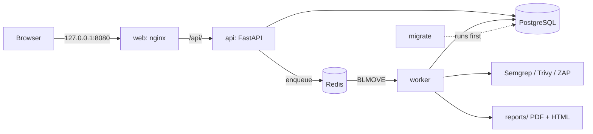

# VulnCompass

**ระบบประเมินความปลอดภัยและออกรายงานอัตโนมัติ** VulnCompass สแกนโปรเจกต์ด้วยเครื่องมือ 4 ตัว รวมผลเป็นรายการเดียวที่ตัดตัวซ้ำแล้วและเรียงตามความเสี่ยง ติดตามสถานะของแต่ละช่องโหว่ข้ามรอบสแกน และออกรายงาน PDF ภาษาไทย ใช้งานได้ 3 ทาง: หน้าเว็บ, command line หรือเป็นด่านตรวจความปลอดภัย (security gate) ใน CI

[English](README.md)


```powershell
docker compose --profile app up -d --build
# แล้วเปิด http://localhost:8080
```

---

## ระบบทำอะไร

| ประเภท | เครื่องมือ | สแกนอะไร |
|---|---|---|
| SAST | Semgrep | source code |
| Dependency | Trivy `fs` | library ในไฟล์ lock |
| Container | Trivy `image` | package ของระบบและ library ใน Docker image |
| DAST | OWASP ZAP | เว็บที่รันอยู่จริง |

หลังสแกนเสร็จ pipeline จะ:

1. **แปลงผล**ของแต่ละเครื่องมือให้อยู่ในรูปแบบเดียวกัน และสร้าง fingerprint ที่คงที่ให้แต่ละช่องโหว่ fingerprint ของ Semgrep สร้างจากโค้ดที่ match ไม่ใช่เลขบรรทัด แม้บรรทัดรอบๆ จะเลื่อน ก็ยังนับเป็นช่องโหว่ตัวเดิม
2. **ตัดตัวซ้ำ**ทั้งภายในรอบเดียวกันและข้ามรอบ ส่วนในรายงาน CVE เดียวกันที่เจอทั้งจาก dependency scan และ container scan จะแสดงครั้งเดียวพร้อมระบุทั้งสองเครื่องมือ
3. **ติดตามสถานะ**: ช่องโหว่ที่สแกนรอบใหม่แล้วไม่เจอจะถูกเปลี่ยนเป็น `fixed` ให้อัตโนมัติ
4. **เพิ่มข้อมูล**: จับคู่ CWE กับ OWASP Top 10 2021, ดึงคะแนน [EPSS](https://www.first.org/epss/) (โอกาสถูกโจมตีจริง) จาก FIRST.org และคำแนะนำการแก้ไข (จาก OWASP Cheat Sheets และให้ Gemini สรุปได้ถ้าต้องการ)
5. **คิดคะแนนความเสี่ยง** 0–10 จาก severity, CVSS และ EPSS ช่องโหว่ระดับ medium ที่กำลังถูกโจมตีจริงจึงอาจอยู่สูงกว่าระดับ high ที่ไม่มีใครโจมตี
6. **ออกรายงาน**เป็น HTML dashboard ที่กรองและค้นหาได้ และ PDF สำหรับพิมพ์

## ใช้งานได้ 3 ทาง

| ช่องทาง | ใช้ทำอะไร | วิธีเข้า |
|---|---|---|
| **หน้าเว็บ** (React + TypeScript) | login, ดู dashboard, สั่งสแกน, ดูสถานะสด, ดาวน์โหลดหรือพิมพ์รายงาน | `http://localhost:8080` |
| **CLI** | สแกนจาก script หรือสั่งครั้งเดียว | `python run_pipeline.py --project NodeGoat --repo ...` |
| **CI/CD gate** | ทำให้ build ไม่ผ่านเมื่อเจอช่องโหว่ถึงระดับที่กำหนด | `--fail-on critical` (exit code 1) |

ทั้ง 3 ทางเรียกฟังก์ชันหลักตัวเดียวกันคือ `run_full_pipeline()`

<details>
<summary>ภาพหน้าจอ</summary>

| หน้าการสแกน | รายงาน PDF |
|---|---|
|  |  |

</details>

## สถาปัตยกรรม



- **api**: FastAPI login ด้วย session cookie (หน้าเว็บ) หรือ `X-API-Key` (script) และไม่สแกนใน request เอง แต่ใส่งานเข้าคิวเสมอ
- **worker**: หยิบงานด้วย Redis `BLMOVE` ไปไว้ในรายการ "กำลังทำ" (reliable queue) ถ้า worker ถูกปิดกลางคัน รอบหน้าที่เปิดจะกู้งานนั้นให้ ไม่ปล่อยค้างเป็น `running`
- **migrate**: สร้างฐานข้อมูลใหม่หรือรัน Alembic migration แล้วจบ `api` และ `worker` จะเริ่มหลังขั้นนี้สำเร็จเท่านั้น

## การออกแบบด้านความปลอดภัย

VulnCompass เป็นเครื่องมือ security ตัวระบบเองจึงต้องปลอดภัย สิ่งที่ตั้งใจทำ:

| ด้าน | ทำอะไร |
|---|---|
| การยืนยันตัวตน | เก็บรหัสผ่านด้วย Argon2 · session เก็บฝั่ง server ใน Redis: cookie (`HttpOnly`, `SameSite=Strict`) มีแค่รหัสสุ่ม และ Redis เก็บแค่ SHA-256 ของรหัสนั้น กด logout แล้วสำเนา cookie ใช้ไม่ได้ทันที · จำกัดการ login ผิดตาม IP และชื่อผู้ใช้ โดยเก็บตัวนับใน Redis จึงไม่หายเมื่อ restart · เทียบ API key แบบใช้เวลาคงที่ (constant time) · ถ้าไม่ได้ตั้ง API key หรือ Redis ใช้ไม่ได้ จะปฏิเสธทั้งหมด (fail closed, 503) |
| ข้อมูลที่ใช้สั่งสแกน | path ต้องอยู่ใน allowlist (ใช้ `realpath` + `commonpath` จึงหลบออกด้วย `..` ไม่ได้) · host ของ DAST ต้องอยู่ใน allowlist · ตรวจชื่อ image ไม่ให้ Trivy อ่านเป็น option |
| ดาวน์โหลดรายงาน | ตรวจ path ที่เก็บในฐานข้อมูลซ้ำว่าอยู่ใต้ `reports/` จริงก่อนส่งไฟล์ |
| XSS ในรายงาน | ชื่อช่องโหว่มาจากโค้ดที่คนอื่นเขียน template ทุกตัวจึง autoescape เสมอ และมี test ที่จะพังทันทีถ้ามีคนปิด escape |
| ข้อความ error | ฐานข้อมูลหรือ Redis ล่มตอบ 503 พร้อมข้อความทั่วไป ส่วน host, port และชื่อผู้ใช้บันทึกไว้แค่ใน log ฝั่ง server |
| Container | รันเป็น user ที่ไม่ใช่ root · เปิดออกมาที่เครื่องแค่ `127.0.0.1:8080` (port ของ API อยู่ข้างในเท่านั้น) · โฟลเดอร์ที่จะสแกน mount แบบอ่านอย่างเดียว · ไม่ใส่ `.env` ลงใน image · **ไม่ mount `docker.sock`** (ดู trade-off ด้านล่าง) |
| Reverse proxy | nginx ตั้ง `X-Forwarded-For` เป็น `$remote_addr` แทนการต่อท้าย header ที่ผู้ใช้ส่งมา ผู้โจมตีจึงปลอม IP ใหม่ทุกครั้งที่เดารหัสผ่านเพื่อหลบ rate limit ไม่ได้ |
| Supply chain | ล็อก GitHub Actions ด้วย commit SHA · ตรวจ SHA-256 ของ Trivy · `npm ci --ignore-scripts` · ล็อกเวอร์ชัน base image · ใช้เวอร์ชันใหม่หลังออกมาแล้วอย่างน้อย 2 สัปดาห์ · token ของ CI อ่านได้อย่างเดียว |
| สแกนตัวเอง | ทุกครั้งที่ push CI จะใช้ VulnCompass สแกนโค้ดของตัวเองผ่าน gate เดียวกัน และผ่านทุกครั้ง Trivy ไม่เจอ library ที่มีช่องโหว่ ส่วนคำเตือน Semgrep 2 ข้อตรวจแล้ว เขียนเหตุผลไว้ในโค้ด และมี test รองรับ |

### Threat model (ฉบับย่อ)

| ภัยคุกคาม | วิธีป้องกัน |
|---|---|
| ผู้ใช้ที่ login แล้วสั่ง worker ให้สแกนหรืออ่านไฟล์อื่นในเครื่อง | allowlist ของ path, mount แบบอ่านอย่างเดียว, ตรวจชื่อ image |
| repo ที่ถูกสแกนแฝงสคริปต์มากับรายงาน (stored XSS) | autoescape ทุก template + regression test |
| เดารหัสผ่าน | rate limit ตาม IP จริงของผู้ใช้ เก็บใน Redis จึงไม่หายเมื่อ restart และปลอม proxy header ไม่ได้ |
| session cookie ถูกขโมย | session อยู่ฝั่ง server กด logout หรือหมดอายุแล้วสำเนา cookie ทุกชุดใช้ไม่ได้ |
| ความลับรั่ว | ความลับอยู่ใน `.env` เท่านั้น (อยู่ใน gitignore และไม่ถูกใส่ใน image) · Postgres และ Redis เปิดเฉพาะ localhost และ Redis ต้องใส่รหัสผ่าน |
| dependency ของ CI ถูกแก้ | action ล็อกด้วย SHA, binary ตรวจ checksum, token อ่านอย่างเดียว |

**เหตุการณ์จริงระหว่างพัฒนา:** เจอรหัสผ่านฐานข้อมูลถูก commit อยู่ใน `alembic.ini` จึงเปลี่ยนรหัส (rotate) แทนการเขียน git history ใหม่ แก้ให้อ่านค่าจาก environment และเปลี่ยนให้ port ของฐานข้อมูลเปิดเฉพาะ localhost แล้วตรวจยืนยันว่ารหัสเก่าใช้ไม่ได้แล้ว

**Trade-off:** DAST ใช้ใน Docker ไม่ได้ เพราะ ZAP เป็น container แยก ถ้าจะให้ worker เปิด container ได้ต้อง mount `docker.sock` ซึ่งเท่ากับให้สิทธิ์ root ทั้งเครื่อง DAST จึงใช้ได้เฉพาะตอนรัน worker บนเครื่อง ส่วนแนวทางที่ปลอดภัยกว่าในอนาคตคือแยก ZAP เป็น service ที่เรียกผ่าน API

## เริ่มใช้งานด้วย Docker

ต้องมี: Docker Desktop

```powershell
Copy-Item .env.example .env      # แล้วเติมรหัสผ่านและค่าลับต่างๆ รวมถึง REDIS_PASSWORD
docker compose --profile app up -d --build
docker compose exec api python manage_users.py create admin
```

เปิด `http://localhost:8080` แล้ว login จากนั้นสั่งสแกนโฟลเดอร์ใต้ `../Targets` โดยใช้ path ใน container เช่น `/targets/NodeGoat` ถ้าจะใช้โฟลเดอร์อื่นให้ตั้ง `TARGETS_DIR` ใน `.env`

```powershell
docker compose logs -f worker         # ดูการสแกน
docker compose --profile app stop     # ปิด (ห้ามใส่ -v เพราะจะลบ volume ของฐานข้อมูล)
```

`docker compose up -d` ที่ไม่มี `--profile app` จะเปิดแค่ PostgreSQL กับ Redis ซึ่งเป็นแบบที่ใช้ตอนพัฒนาในเครื่องตามหัวข้อถัดไป

## พัฒนาในเครื่อง

ต้องมี: Python 3.14, Node 24, Docker Desktop, [Trivy](https://trivy.dev), GTK3 runtime (สำหรับ WeasyPrint บน Windows)

```powershell
python -m venv venv
venv\Scripts\activate
pip install -r requirements-dev.txt
Copy-Item .env.example .env
docker compose up -d
python init_db.py
python seed_cwe_mapping.py
```

เปิดแต่ละคำสั่งใน terminal แยกกัน:

```powershell
uvicorn main:app --reload          # API ที่ 127.0.0.1:8000
cd frontend; npm ci; npm run dev   # หน้าเว็บที่ http://localhost:5173
python worker.py                   # worker สำหรับสแกน
```

ห้ามรัน worker ในเครื่องพร้อมกับ worker ใน Docker ทั้งสองตัวตั้งใจให้ใช้ Redis คนละ DB เพื่อให้แต่ละตัวหยิบเฉพาะงานของตัวเอง

### CLI

```powershell
python run_pipeline.py --project NodeGoat --repo C:\Allprojects\Targets\NodeGoat --scans sast,dependency
python run_pipeline.py --project NodeGoat --repo C:\Allprojects\Targets\NodeGoat --fail-on high
python run_pipeline.py --help
```

## Test และ CI

```powershell
pytest -q                          # 128 test
cd frontend; npm run lint; npm run build
```

| Workflow | ทำอะไร |
|---|---|
| `tests.yml` | pytest และ lint + build ของหน้าเว็บ |
| `security-scan.yml` | สร้าง Postgres ชั่วคราว → `init_db.py` → Semgrep + Trivy สแกน repo นี้ → `--fail-on critical` → อัปโหลดรายงานเป็น artifact |

## โครงสร้างโปรเจกต์

| path | หน้าที่ |
|---|---|
| `main.py` | FastAPI: auth, projects, findings, scans, reports |
| `pipeline.py`, `run_pipeline.py` | pipeline หลักและ CLI |
| `worker.py`, `scan_queue.py` | reliable queue บน Redis และ worker |
| `scanners/`, `normalizer.py` | เรียกเครื่องมือและแปลงผลให้อยู่ในรูปแบบเดียวกัน |
| `save_findings.py` | ตัดตัวซ้ำและติดตามสถานะ open/fixed |
| `risk_scoring.py`, `epss.py`, `apply_cwe_mapping.py` | เพิ่มข้อมูลและคิดคะแนนความเสี่ยง |
| `security_gate.py` | ตรรกะของ `--fail-on` |
| `generate_report.py`, `templates/` | รายงาน HTML และ PDF |
| `scan_policy.py` | allowlist ของ path และ host |
| `frontend/` | หน้าเว็บ React + TypeScript และ config ของ nginx |
| `alembic/`, `init_db.py` | migration ของฐานข้อมูล |
| `docs/` | รายงานการพัฒนาแต่ละขั้น (ภาษาไทย) |

## License และการแจ้งช่องโหว่

เผยแพร่ภายใต้ [MIT License](LICENSE) ถ้าพบช่องโหว่ใน VulnCompass ดูวิธีแจ้งได้ที่ [SECURITY.md](SECURITY.md)

## เทคโนโลยีที่ใช้

Python 3.14 · FastAPI · SQLAlchemy 2 · Alembic · PostgreSQL 16 · Redis 7 · WeasyPrint · Jinja2 · React 19 · TypeScript · Vite · Docker Compose · nginx · GitHub Actions · Semgrep · Trivy · OWASP ZAP · FIRST EPSS · Google Gemini
